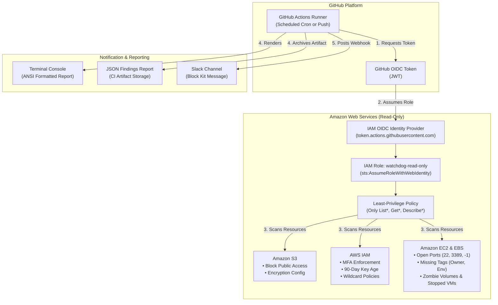

# 🛡️ AWS Misconfiguration Watchdog

[](https://github.com/dhruviscoding/aws-misconfiguration-watchdog/actions/workflows/ci.yml)
[](https://www.python.org/downloads/)
[](https://github.com/astral-sh/ruff)
[](LICENSE)
[-success.svg)](#-cost-and-free-tier-guarantee)

> **A production-ready DevSecOps automation tool that audits AWS accounts for security posture drift and resource hygiene issues, delivering actionable alerts to Slack.**

Built as a portfolio project demonstrating **least-privilege IAM design, secretless OIDC authentication, extensible Python architecture, and automated test-driven development with Moto.**

---

## 📑 Table of Contents

- [Overview](#-overview)
- [Architecture](#-architecture)
- [Security Checks Included](#-security-checks-included)
- [Zero Cost Guarantee](#-zero-cost-guarantee)
- [Strict Read-Only IAM Policy](#-strict-read-only-iam-policy)
- [Quick Start (Local Development)](#-quick-start-local-development)
- [Deployment & GitHub Actions OIDC Setup](#-deployment--github-actions-oidc-setup)
- [Adding a New Check (Developer Guide)](#-adding-a-new-check-developer-guide)
- [Sample Slack Alerts](#-sample-slack-alerts)
- [Limitations & Future Roadmap](#-limitations--future-roadmap)

---

## 🔍 Overview

Cloud misconfigurations remain the leading cause of AWS security incidents and budget overruns. **AWS Misconfiguration Watchdog** provides proactive detection without the overhead or billing surprises of heavy enterprise platforms:

- **100% Free**: Operates solely within AWS free tier and zero-cost control-plane APIs.
- **Secretless CI/CD**: Uses GitHub Actions OpenID Connect (OIDC) to assume an IAM role dynamically—no long-lived AWS keys stored in GitHub Secrets.
- **Strictly Read-Only**: Enforces least-privilege `List*`, `Get*`, and `Describe*` permissions. It is architecturally incapable of modifying or deleting AWS resources.
- **Actionable Alerts**: Generates Slack Block Kit notifications categorized by severity (`HIGH`, `MEDIUM`, `LOW`) with exact remediation CLI commands.
- **Fully Tested In-Memory**: Uses `pytest` and `moto` to achieve 100% offline unit test coverage without touching live AWS infrastructure.

---

## 🏛️ Architecture



---

## 🛡️ Security Checks Included

Each check is implemented as an independent Python module adhering to a standard interface:

| Check Name | Target Resource | Severity | Condition Flagged | Remediation Action |
| :--- | :--- | :---: | :--- | :--- |
| `s3-block-public-access` | S3 Bucket | **HIGH** | S3 Block Public Access is disabled or partially turned off | Enable all 4 BPA controls via `put-public-access-block` |
| `s3-public-policy` | S3 Bucket | **HIGH** | Bucket policy grants public principal access | Remove wildcard `*` principals from policy |
| `s3-public-acl` | S3 Bucket | **HIGH** | ACL grants read/write to `AllUsers` or `AuthenticatedUsers` | Reset ACL to `private` |
| `s3-unencrypted-bucket` | S3 Bucket | **MEDIUM** | Default SSE encryption rule is not configured | Enforce SSE-S3 or SSE-KMS default encryption |
| `iam-user-no-mfa` | IAM User | **HIGH** | Console user has login profile without MFA | Enforce hardware or virtual MFA |
| `iam-old-access-key` | IAM Key | **MEDIUM** | Active access key older than 90 days | Rotate credentials and deactivate old key |
| `iam-admin-wildcard-policy` | IAM Policy | **HIGH** | Policy allows `Action: "*"` on `Resource: "*"` | Scope down permissions to specific actions and ARNs |
| `sg-open-all-ports` | Security Group | **HIGH** | Ingress open to `0.0.0.0/0` on all protocols (`-1`) | Revoke ingress rule |
| `sg-open-ssh` | Security Group | **HIGH** | Ingress open to `0.0.0.0/0` on port 22 | Revoke ingress; use AWS SSM Session Manager |
| `sg-open-rdp` | Security Group | **HIGH** | Ingress open to `0.0.0.0/0` on port 3389 | Revoke ingress; restrict to corporate VPN CIDR |
| `ec2-missing-required-tags` | EC2 Instance | **LOW** | Missing mandatory `Owner` or `Environment` tags | Apply tags via `ec2 create-tags` |
| `ebs-missing-required-tags` | EBS Volume | **LOW** | Missing mandatory `Owner` or `Environment` tags | Apply tags via `ec2 create-tags` |
| `ec2-idle-stopped-instance` | EC2 Instance | **MEDIUM** | Instance stopped for $> 7$ days incurring idle EBS cost | Snapshot root volume and terminate instance |
| `ebs-unattached-volume` | EBS Volume | **MEDIUM** | Volume in `available` state incurring idle storage fees | Snapshot and delete unattached volume |

---

## 💰 Zero Cost Guarantee

> [!NOTE]
> This project is designed to run at **$0.00 cost indefinitely**.
> Before using any AWS feature, here is why you will never receive a bill:

1. **AWS IAM (OIDC & Roles)**: Free forever. AWS does not charge for IAM users, roles, policies, or OIDC identity providers.
2. **Control-Plane API Calls**: AWS does not charge for `Describe*`, `List*`, or `Get*` API calls on EC2, IAM, or S3.
3. **Data Transfer**: The small JSON responses exchanged during API calls fall well within AWS's 100 GB/month free internet egress allowance.
4. **GitHub Actions**: Runs within GitHub's free tier (2,000 free minutes/month for private repos; unlimited for public repos).
5. **Slack Webhooks**: Slack incoming webhooks are free on all free Slack workspaces.
6. **Local Testing (Moto)**: Tests run entirely in-memory on your local machine with zero AWS API calls.

---

## 🔒 Strict Read-Only IAM Policy

The tool requires zero mutation permissions. Below is the exact IAM policy deployed by Terraform:

```json
{
  "Version": "2012-10-17",
  "Statement": [
    {
      "Sid": "S3HygieneAndSecurityInspection",
      "Effect": "Allow",
      "Action": [
        "s3:ListAllMyBuckets",
        "s3:GetBucketLocation",
        "s3:GetBucketPolicyStatus",
        "s3:GetPublicAccessBlock",
        "s3:GetBucketAcl",
        "s3:GetEncryptionConfiguration"
      ],
      "Resource": "*"
    },
    {
      "Sid": "IAMSecurityInspection",
      "Effect": "Allow",
      "Action": [
        "iam:ListUsers",
        "iam:GetLoginProfile",
        "iam:ListMFADevices",
        "iam:ListAccessKeys",
        "iam:ListPolicies",
        "iam:GetPolicy",
        "iam:GetPolicyVersion",
        "iam:ListUserPolicies",
        "iam:GetUserPolicy"
      ],
      "Resource": "*"
    },
    {
      "Sid": "EC2AndSecurityGroupInspection",
      "Effect": "Allow",
      "Action": [
        "ec2:DescribeSecurityGroups",
        "ec2:DescribeInstances",
        "ec2:DescribeVolumes",
        "ec2:DescribeTags"
      ],
      "Resource": "*"
    }
  ]
}
```

### Why Each Permission is Necessary

- `s3:ListAllMyBuckets` / `s3:GetBucketLocation`: Enumerates all buckets and resolves regional endpoints to avoid 301 redirection errors.
- `s3:GetPublicAccessBlock` / `s3:GetBucketPolicyStatus` / `s3:GetBucketAcl`: Detects if S3 Block Public Access is disabled or if bucket policies/ACLs expose data to the public internet.
- `s3:GetEncryptionConfiguration`: Verifies if default server-side encryption is enforced.
- `iam:ListUsers` / `iam:GetLoginProfile` / `iam:ListMFADevices`: Detects console users with active passwords who lack Multi-Factor Authentication.
- `iam:ListAccessKeys`: Inspects active credential creation dates to flag keys older than 90 days.
- `iam:ListPolicies` / `iam:GetPolicy` / `iam:GetPolicyVersion` / `iam:GetUserPolicy`: Inspects JSON policy statements to detect dangerous `*` actions on `*` resources.
- `ec2:DescribeSecurityGroups`: Inspects ingress rules for unrestricted access (`0.0.0.0/0`) on SSH, RDP, or all ports.
- `ec2:DescribeInstances` / `ec2:DescribeVolumes`: Discovers untagged assets, stopped instances older than 7 days, and unattached EBS volumes.

---

## 🚀 Quick Start (Local Development)

### 1. Clone & Set Up Virtual Environment

```bash
git clone https://github.com/dhruviscoding/aws-misconfiguration-watchdog.git
cd aws-misconfiguration-watchdog

python -m venv .venv
# Windows:
.venv\Scripts\activate
# macOS/Linux:
source .venv/bin/activate

pip install -e ".[dev]"
```

### 2. Run Tests & Linter (No AWS Account Required!)

```bash
# Run 28 Moto unit tests
pytest -v

# Run Ruff linter
ruff check .
```

### 3. Run Watchdog Locally in Dry-Run Mode

```bash
# Uses your local AWS CLI profile; does not send messages to Slack
python -m watchdog.cli --profile my-dev-profile --region us-east-1 --dry-run
```

Output:
```text
==============================================================================
  AWS MISCONFIGURATION WATCHDOG - SECURITY & HYGIENE REPORT
==============================================================================

  🔴 HIGH: 2  |  🟡 MEDIUM: 1  |  🔵 LOW: 1  |  TOTAL: 4

  1. [HIGH] s3-block-public-access (us-east-1)
     Resource: production-customer-data
     Issue:    S3 Block Public Access is completely disabled on this bucket.
     Fix:      aws s3api put-public-access-block --bucket production-customer-data --public-access-block-configuration BlockPublicAcls=true,IgnorePublicAcls=true,BlockPublicPolicy=true,RestrictPublicBuckets=true

  2. [HIGH] sg-open-ssh (us-east-1)
     Resource: sg-0123456789abcdef0 (bastion-public-sg)
     Issue:    Security group 'bastion-public-sg' (sg-0123456789abcdef0) exposes SSH (port 22) to the public internet.
     Fix:      aws ec2 revoke-security-group-ingress --group-id sg-0123456789abcdef0 --protocol tcp --port 22 --cidr 0.0.0.0/0 (use AWS SSM Session Manager instead).

  3. [MEDIUM] ebs-unattached-volume (us-east-1)
     Resource: vol-0987654321fedcba0
     Issue:    EBS volume 'vol-0987654321fedcba0' (50 GiB gp3) is unattached ('available') and generating idle storage costs.
     Fix:      Create a final snapshot if needed, then delete: aws ec2 delete-volume --volume-id vol-0987654321fedcba0

  4. [LOW] ec2-missing-required-tags (us-east-1)
     Resource: i-0abcde1234567890f
     Issue:    EC2 instance 'i-0abcde1234567890f' is missing required tags: Owner, Environment.
     Fix:      aws ec2 create-tags --resources i-0abcde1234567890f --tags Key=Owner,Value=<owner-email> Key=Environment,Value=<env>
==============================================================================
```

---

## ⚙️ Deployment & GitHub Actions OIDC Setup

### Step 1: Deploy IAM OIDC Role with Terraform

```bash
cd terraform
cp terraform.tfvars.example terraform.tfvars
```

Edit `terraform.tfvars`:
```hcl
aws_region    = "us-east-1"
github_org    = "your-github-username"
github_repo   = "aws-misconfiguration-watchdog"
github_branch = "main"
```

Apply Terraform:
```bash
terraform init
terraform apply
```

Note the output `watchdog_role_arn`.

### Step 2: Configure GitHub Repository Secrets

In your GitHub repository, navigate to **Settings > Secrets and variables > Actions > New repository secret**:

1. `AWS_ROLE_ARN`: The ARN from Terraform output (e.g., `arn:aws:iam::123456789012:role/github-actions-watchdog-read-only`).
2. `SLACK_WEBHOOK_URL`: Your Slack Incoming Webhook URL (e.g., `https://hooks.slack.com/services/T.../B.../...`).

### Step 3: Trigger Daily or On-Demand Scans

The scheduled workflow (`.github/workflows/daily-scan.yml`) automatically runs every day at 08:00 UTC. You can also trigger it manually at any time via the **Run workflow** button under GitHub Actions.

---

## 🧩 Adding a New Check (Developer Guide)

Adding a new security or hygiene check takes under 5 minutes thanks to the modular `BaseCheck` interface.

### 1. Create a Check Module in `watchdog/checks/`

Create `watchdog/checks/rds_public.py`:

```python
import boto3
from watchdog.checks.base import BaseCheck
from watchdog.models import Finding, Severity

class RDSPublicCheck(BaseCheck):
    @property
    def name(self) -> str:
        return "rds-public-instance"

    @property
    def description(self) -> str:
        return "Detects publicly accessible RDS database instances."

    def run(self, session: boto3.Session, region: str = "us-east-1") -> list[Finding]:
        findings = []
        rds = session.client("rds", region_name=region)
        
        paginator = rds.get_paginator("describe_db_instances")
        for page in paginator.paginate():
            for db in page.get("DBInstances", []):
                if db.get("PubliclyAccessible", False):
                    db_id = db["DBInstanceIdentifier"]
                    findings.append(
                        Finding(
                            check_name=self.name,
                            resource_id=db_id,
                            severity=Severity.HIGH,
                            explanation=f"RDS instance '{db_id}' is configured as publicly accessible.",
                            suggested_fix=f"aws rds modify-db-instance --db-instance-identifier {db_id} --no-publicly-accessible",
                            region=region,
                        )
                    )
        return findings
```

### 2. Register in `watchdog/runner.py`

Add your class to `DEFAULT_CHECKS`:

```python
DEFAULT_CHECKS = [
    S3Check,
    IAMCheck,
    SecurityGroupCheck,
    EC2HygieneCheck,
    RDSPublicCheck,  # <--- Registered here
]
```

### 3. Add Moto Unit Tests in `tests/`

Write tests covering both compliant (`PubliclyAccessible=False`) and non-compliant (`PubliclyAccessible=True`) cases, run `pytest`, and you're done!

---

## 💬 Sample Slack Alerts

### When Findings are Detected

```text
🛡️ AWS Misconfiguration Watchdog Report
*Scan Summary:*
🔴 HIGH: `2`   🟡 MEDIUM: `1`   🔵 LOW: `1`   |   Total Issues: `4`
──────────────────────────────────────────────────────────────────
🔴 #1 [HIGH] s3-block-public-access
• Resource: `production-customer-data` (us-east-1)
• Issue: S3 Block Public Access is completely disabled on this bucket.
• Suggested Fix: `aws s3api put-public-access-block --bucket production-customer-data --public-access-block-configuration BlockPublicAcls=true,IgnorePublicAcls=true,BlockPublicPolicy=true,RestrictPublicBuckets=true`

🔴 #2 [HIGH] sg-open-ssh
• Resource: `sg-0123456789abcdef0 (bastion-public-sg)` (us-east-1)
• Issue: Security group 'bastion-public-sg' exposes SSH (port 22) to the public internet.
• Suggested Fix: `aws ec2 revoke-security-group-ingress --group-id sg-0123456789abcdef0 --protocol tcp --port 22 --cidr 0.0.0.0/0 (use AWS SSM Session Manager instead).`

🟡 #3 [MEDIUM] ebs-unattached-volume
• Resource: `vol-0987654321fedcba0` (us-east-1)
• Issue: EBS volume 'vol-0987654321fedcba0' (50 GiB gp3) is unattached ('available') and generating idle storage costs.
• Suggested Fix: `aws ec2 delete-volume --volume-id vol-0987654321fedcba0`
```

### When the Account is Clean ("All Clear")

```text
🛡️ AWS Misconfiguration Watchdog Report
*Scan Summary:*
🔴 HIGH: `0`   🟡 MEDIUM: `0`   🔵 LOW: `0`   |   Total Issues: `0`

✅ *All clear!* No security misconfigurations or hygiene issues detected in this scan.
```

---

## 🔮 Limitations & Future Roadmap

- **Multi-Region Scanning**: Currently accepts target regions via `--region`. Future iterations can query `ec2:DescribeRegions` to sweep all enabled AWS commercial regions automatically.
- **AWS Organizations & SCPs**: Expanding to assume organization-level reader roles to aggregate posture across multi-account landing zones.
- **Automated Remediation**: Adding an opt-in `--auto-remediate` mode with CloudTrail approval steps (e.g., applying missing tags or enabling Block Public Access).
- **Security Hub / SIEM Ingestion**: Formatting findings to ASFF (AWS Security Finding Format) for native ingestion into AWS Security Hub and Amazon OpenSearch.

---

## 📜 License

Distributed under the MIT License. See [LICENSE](LICENSE) for more information.
